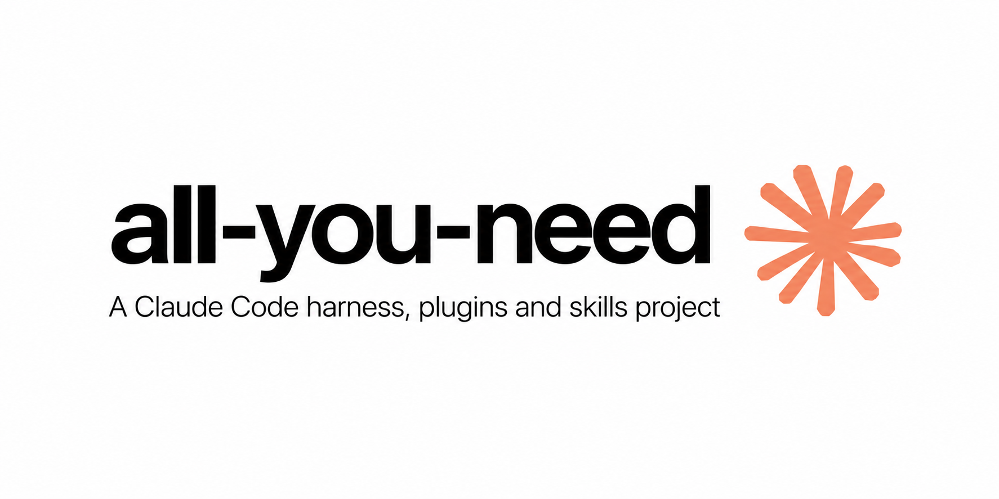

# all-you-need

   

Stop losing work to unverified edits. This lean Claude Code harness forces every change to prove itself — tests, evidence, no silent failures — and gets out of your way when you move fast.

```bash
git clone <your-fork> && cd all-you-need && ./install.sh --yes
# next session: /verify — build, type, lint, tests, scan, diff in one PASS/FAIL report
```

## 60-second demo

```text
You: add a timeout to the fetch call
Claude: [edits client.py, runs pytest — 1 failed]
Claude: Timeout added (5s). Not verified: integration suite needs network.
        Proof: python -m pytest tests/test_client.py -q → 4 passed, 1 failed (timeout case)
```

Vanilla would have said "done". Here the failing test, the exact command, and the honest label are in your face before you merge.

| Vanilla Claude Code | With all-you-need |
| --- | --- |
| "Done" with no proof | `Not verified:` line or a passing check, enforced by the Stop hook |
| Secrets one misclick away | `.env`/keys blocked + OSV CVE check on every manifest edit |
| Lost context after compact | Checkpoint + task ledger resume where you stopped |
| Research from memory | `/research` with citations, link checks, primary sources |

## 5-minute trial (keep it or drop it)

1. `./install.sh --yes` — one command, plugin loads next session.
2. Ask Claude to add a tiny function in a `.py` file, then run `/verify` — build, type, lint, tests, scan, diff in one report.
3. Noise off: `ALL_YOU_NEED_OFF=1` skips all hooks for a session; quoted text (`echo "git commit --no-verify"`) never trips the action guard.
4. Keep it if the gate or secret guard saves one bad push; drop back to vanilla + `security-guidance` if it nags twice in a day.

Contents: [Install](#install) · [Commands](#commands) · [What is inside](#what-is-inside) · [Gates](#how-the-gates-behave) · [Limits](#limits) · [Develop](#develop)

## What is inside

| Part | What it does |
| --- | --- |
| Skill `all-you-need` | The workflow and safety rules. Its operational, reporting and review guidance lives in references loaded only when relevant. |
| Skill `verification-loop` | Six-phase verification with a PASS/FAIL report: build, type check, lint, tests, security scan, diff review. |
| Skill `project-orientation` | Orient before editing: toolchain from the project's own files, lockfile and runtime pins, monorepo layout, instruction files and generated files. |
| Skill `research` | Find out what you do not know: code, docs, then search; current date from the environment; primary sources; optional cited provider research through `/research` with provider setup, query design, citation discipline, prompt-injection and privacy rules. |
| Skill `lessons` | Durable lesson memory: one lesson per file under `.claude/lessons/` with an index, re-injected at session start. |
| Skill `quality-bar` | The 59-point quality bar, mapped to the exact skill, rule or hook that covers each point, with an honest status for each. See `skills/quality-bar/references/coverage.md`. A second matrix, `skills/quality-bar/references/security-and-engineering-coverage.md`, maps the 30 security requirements, the secure-coding, secure-design, 55-point engineering and 178-point full-stack lists. |
| Skill `debugging` | Reproduce, read the whole error, rank hypotheses, fix the root cause, prove with a regression test, loop on new evidence. |
| Skill `refactoring` | Change structure without changing behavior: characterization tests, small verified steps, contracts untouched. |
| Skill `testing-quality` | Tests that can fail: edge cases, regression tests, no rigged or skipped tests, mutation check. |
| Skill `performance-reliability` | Algorithms, N+1 and migrations, concurrency, resource and memory safety, payload efficiency, scalability, cross-platform and container rules. |
| Skill `backend-api` | Backend architecture, REST conventions, versioning, validation, pagination, idempotency, timeouts, transactions, safe migrations, pooling, data lifecycle. |
| Skill `fullstack-integration` | One contract across UI, API and database; auth sync, error propagation, retries, real time, file transfer, session expiry, end-to-end tests. |
| Skill `devops-release` | Production configuration, containers, CI/CD, rollout and rollback, health checks, graceful shutdown, observability, backups, cost, operational impact. |
| Skill `finish-the-job` | Keeps a task ledger so long or multi-part work is completed in full, survives context compaction, and cannot be stopped with items open. |
| Skill `language-standards` | Per-language toolchain commands, idioms and security pitfalls for Python, JavaScript, TypeScript, C, C++, Rust, C#, Go, PHP, HTML and CSS. |
| Skill `code-structure` | Layers, module boundaries, file and function size, naming, project layout for backend, frontend and monorepos. |
| Skill `minimal-diff` | Smallest complete change. No unrequested features, flags or abstractions. |
| Skill `clean-code` | Rules for types, errors, validation, comments, performance, UI accessibility and network code. |
| Skill `secure-code` | Security by default: threat modeling, authentication and authorization, injection, secrets, cryptography, data protection, API and frontend security, supply chain, infrastructure, security testing, AI guardrails, and safe instruction and automation surfaces. Ten reference files. |
| Skill `code-audit` | 20-section security and quality audit checklist for a whole codebase. |
| Skill `harness-audit` | Check this harness for broken structure and wiring, then run behavior evals and capability scenarios. |
| Skill `ui-craft` | One entry point for UI design and implementation: accessibility, layout, component behavior, responsiveness and performance, with detailed references loaded on demand. |
| Skill `re-playbook` | Reverse engineering method, tool stack, and a deep reference (PE/ELF/Mach-O, ABIs, protectors, ROP, Frida, angr). |
| Skill `error-handling` | Error handling strategy: what to handle, where, how to surface it per language, typed errors, boundaries, retries and user-facing messages. |
| Skill `safe-actions` | Conduct for destructive and outward-facing actions, version control, dependencies, network-exposed code and secrets. |
| Skill `delegation` | When and how to hand work to subagents, run independent investigations in parallel, and batch tool calls. |
| Agent `reviewer` | Read-only reviewer. One line per finding, each with evidence. |
| Agent `security-reviewer` | Read-only security review. Traces untrusted input to sinks and reports authorization, injection, secret, crypto and supply-chain findings with a trigger and impact. |
| Agent `silent-failure-hunter` | Read-only review for swallowed errors, dangerous fallbacks, missing timeouts, partial writes and error paths that report success. |
| Agent `test-analyzer` | Read-only review of test quality: missing behavioral coverage, tests that cannot fail, skipped assertions and flaky patterns. |
| Hook `PreToolUse` (secret guard) | Blocks reading `.env`, private keys, keystores and credential files, and commands that read or send them. `.env.example` stays readable. |
| Hook `SessionStart` | Injects the core rules, detected project facts, the pre-compaction checkpoint, the lesson index and the open task ledger. |
| Hook `PreCompact` | Writes `.all-you-need/checkpoint.md` before context compaction: goal, files edited, checks and open items, with credential-like strings redacted. |
| Hook `PostToolUse` (lint) | Flags `any`, swallowed errors, `type: ignore`, TODOs, stubs, emoji and common vulnerable patterns (string-built SQL, `shell=True`, unsafe deserialization, disabled TLS checks, hardcoded secrets) right after an edit. |
| Hook `PostToolUse` (CVE) | When a manifest or lockfile (`requirements.txt`, `package.json`, `package-lock.json`, `Pipfile.lock`, `poetry.lock`, `uv.lock`, `Cargo.toml`, `Cargo.lock`, `go.mod`, `go.sum`) is edited, looks up every pinned dependency in the OSV database and reports advisories. On manifests it also checks that each declared package exists in its registry (hallucinated or typosquatted names), is not brand new, and is not copyleft-licensed. |
| Hook `Stop` | Blocks ending a turn if code was edited after the last passing check; requires a `Not verified:` line; requires a `Security review needed:` line when security-critical files (auth, crypto, secrets, permissions, payments, deploy, or the harness's own hooks, commands, agents and plugin manifests) were edited; blocks while task-ledger items are open; blocks once when explicitly supplied exact text is missing or a source-sensitive claim has no `Verified:`/`Not verified:` line. |
| `templates/settings.json` | Optional hardened permissions, sandbox and telemetry settings to merge into your own. |

The plugin exposes 26 focused skills. Five general-purpose helpers are kept as references under `skills/all-you-need/references/`, and the overlapping web and frontend guides are references under `skills/ui-craft/references/`. Their content is preserved, but Claude sees fewer skill descriptions and loads those details only when the relevant workflow calls for them.

## Commands

| Command | What it does |
| --- | --- |
| `/review` | Review the working-tree diff with evidence for every finding, without editing. |
| `/fact-check` | Extract the factual claims from a draft and verify each one, labeling what remains unknown. |
| `/research` | Research a current external question with citations, using the configured provider or the host's web tools. |
| `/verify` | Run the six-phase verification loop and report PASS, FAIL or PARTIAL with the exact commands. |
| `/security-scan` | Scan hooks, commands, agents, skills, scripts, manifests and the settings template for security problems. |
| `/harness-audit` | Score the harness's own structure and wiring, fix the highest findings, rerun. |
| `/learn` | Turn a correction or confirmed approach into one durable lesson file and index entry. |
| `/checkpoint` | Write a durable checkpoint of the goal, changes, checks and open items before a pause. |

## Audits and evals

```
python3 scripts/harness_audit.py --root .     # static structure and wiring checks
python3 scripts/security_scan.py --root .     # security findings by severity
python3 scripts/run_evals.py                  # deterministic regression evals
```

The security scanner covers hooks, commands, agents, skills, scripts, plugin manifests and the settings template. It does not scan MCP configuration. It uses patterns, not a parser, so a clean result is a floor rather than a proof. The harness audit reports static structure and wiring only; it is not a quality score and cannot grade model output. Deterministic evals check specific hook behaviors. The live check exercises Claude Code with the plugin loaded. The six capability scenarios in `evals/scenarios.md` still need human grading.

## Research

The `research` skill and `/research` command teach the model to research the way the leading engines do, with no API and no key: Gemini and ChatGPT deep research (plan, then search, read, find gaps, search again), Perplexity (varied queries, primary sources, cross-checking, inline citations), Elicit (screen sources by criteria and extract claims into a table), Consensus (grade evidence and count agreement across sources), SciSpace (read the source closely and cite exactly). It scales by depth (quick, standard, deep), keeps tokens low with a claim table instead of transcripts, and uses the host's own search and fetch tools.

It runs automatically. A `UserPromptSubmit` hook (`hooks/research_router.py`) spots a request to search or research ("search for a solution", "look up the latest", "find me a library", "is X still maintained") and injects the method at once, about 400 tokens, only for those prompts. Searching your own code ("search the codebase") is left alone. The depth follows the wording (quick, standard, deep), and error-style requests add a solution-search note: quote the exact error, check the installed version, prefer maintainer docs and issues, verify the fix against that version.

### Optional API bridge

The harness can also query an external research provider through `scripts/web_research.py` and `/research`. It is off until configured and uses only the Python standard library.

| Option | What it does |
| --- | --- |
| `--depth standard\|deep\|max` | Maps to the provider's tiers. Perplexity: `low`, `xhigh`, `ultra`. OpenAI Responses API with `web_search`: reasoning `medium`, `xhigh`, `max`. |
| `--background`, `--resume ID`, `--poll-interval` | Long runs submit, poll politely and can be fetched later. On automatically for the deepest tiers. |
| `--check-links` | Fetches each cited https URL (public hosts only) and tags it ok, dead or unreachable, to catch fabricated or stale citations. |
| `--recency`, `--out`, `--json`, `--max-sources`, `--dry-run` | Freshness filter, save a Markdown result, structured output, source cap, show the resolved target without calling. |

```bash
export PERPLEXITY_API_KEY="..."                      # or: RESEARCH_PROVIDER=openai-responses OPENAI_API_KEY=... RESEARCH_MODEL=gpt-6-astra
python3 scripts/web_research.py "question" --depth max --check-links
```

More providers: `RESEARCH_PROVIDER=anthropic` (Claude's `web_search` tool, for example `RESEARCH_MODEL=claude-opus-5-5`, `--depth` sets the search budget) and `RESEARCH_PROVIDER=gemini` (Google's Deep Research agents through the Interactions API, always background).

Scholarly and code search, keyless by default: `python3 scripts/scholar_search.py "topic" --mode newest|best|balanced --since 2025` queries OpenAlex, Semantic Scholar, arXiv, Crossref and GitHub, merges duplicates, ranks papers and repositories separately, and adds Consensus and Elicit when `CONSENSUS_API_KEY` or `ELICIT_API_KEY` is set. A rate-limited or failing source is reported and skipped. `skills/research/references/engines.md` lists every engine, how to reach it and what was verified, including the ones with no public API yet (Gemini 4 Carbon) and the one that does not recommend web search for now (Kimi K3.1 Pro).

Token use: tool output is capped. `web_research.py` prints at most 6000 answer characters (`--print-chars`) and saves the full text and sources under `.all-you-need/research/`; `scholar_search.py` prints the top 6 papers and 4 repositories with short abstracts (`--top`, or `--json` for everything). The research skill loads provider details only when needed.

Notes, from the providers' documentation in November 2026:
- A Perplexity Max subscription does not include API credits. The API is pay-as-you-go with its own key.
- "GPT-6.1 ASTRA MAX" is not a model id. OpenAI lists `gpt-6-astra`, `gpt-6.1-sol`, `gpt-6.1-terra` and `gpt-6-luna`; GPT-6.1 Astra has no public API id. `max` is a reasoning-effort setting. The script never guesses a model id: `openai-responses` and `openai-compatible` refuse to run without `RESEARCH_MODEL`.
- Keys are read from the environment only, never written to disk, and redacted from errors. Redirects are refused so a key cannot follow one to another host.

With no key, `/research` falls back to the host's WebSearch and WebFetch tools. Provider answers and citations are leads, not proof: open the primary source, check its date and the version it covers, and cite what you read. A query leaves the machine, so do not include secrets, private source code or personal data without authorization. Results saved under `.all-you-need/research/` are gitignored. To let the sandbox reach the providers, add `api.perplexity.ai` or `api.openai.com` to your sandbox allowlist (the settings template lists them).

## Bundled plugins

The internal `language-standards`, `ui-craft`, `backend-api`, `devops-release` and `testing-quality` skills use Claude Code's path-scoped skill activation. Claude receives the relevant full guide when it works on matching project files; detailed skill bodies stay unloaded otherwise. Their short descriptions remain available to Claude for skill selection. See the [Claude Code skills docs](https://code.claude.com/docs/en/skills) for `paths` behavior. Claude Code loads enabled plugins as a unit, so optional companions are installed at local project scope; see the [plugin overview](https://code.claude.com/docs/en/plugins/overview).

Optional: `./install.sh --with-companions --project-dir PATH` detects project languages and installs only matching language-server plugins plus `security-guidance` for source-code projects. They are installed at local scope in that project, so they do not load in unrelated projects. A missing companion does not affect `all-you-need`. The default install adds no companion marketplace or plugins.

| Plugin | Marketplace | Why it is here |
| --- | --- | --- |
| Language-server plugins | `claude-plugins-official` | Installs only the plugin matching a detected project language: Rust, C/C++, Python, TypeScript/JavaScript, Go, C#, or PHP |
| `security-guidance` | `claude-plugins-official` | Added locally when project source files are detected |

## Third-party skills

58 more skills (web design, animation, video, Rust, C, SwiftUI, React, security and others) are not copied into this repo. `skills-manifest.json` lists each one with its source repository, and `scripts/install-skills.sh` clones the sources and installs any that are missing into `~/.claude/skills`. Sources are not pinned, so you get each repo's default branch.

```
bash scripts/install-skills.sh
```

## Install

Clone the repo, then run the installer. The default installs the plugin and required Git/Python prerequisites for its hooks. It does not install language servers, third-party skills, or companion plugins. Optional tools and companion plugins are selected from the target project's files; `--project-dir` defaults to the current directory.

```
./install.sh
# optional: developer tools, companion plugins and third-party skills
./install.sh --with-tools --with-companions --project-dir /path/to/project
# third-party skill bundle, installed separately on the user account
./install.sh --with-skills
```

Options: `--yes` (do not ask before installing required packages), `--dry-run` (print every command, change nothing), `--with-tools`, `--with-skills`, `--with-companions`, `--project-dir PATH`, and `--repo <github-user>/all-you-need` (install from GitHub instead of the local clone). Extras are off by default. `--with-tools` installs binaries only for detected project languages. `--with-companions` installs matching plugins at local scope in the target project. `--with-skills` clones all 58 optional third-party skills to your user skills directory.

| OS | Package manager | Distro hint | Installs |
| --- | --- | --- | --- |
| macOS | Homebrew | — | Base: git and Python. Optional: only detected language servers |
| Linux | apt-get / dnf / pacman / zypper / apk | debian / fedora / arch / suse / alpine (from `/etc/os-release`, shown in the `OS:` line) | Base: git and Python. Optional: only detected language servers |
| Windows | winget, from Git Bash or MSYS | WSL counts as Linux | Base: Git and Python. Optional: only detected language servers |

Language servers for Python, TypeScript, PHP, Go and C# need `npm`, `go` or `dotnet`; if a runtime is missing the script reports it and skips that tool. It does not install Node, Go or .NET for you. `--dry-run` shows the selected tools and project-local plugin commands before making changes.

Native PowerShell and cmd cannot run `.sh` files: use Git Bash, or WSL (which counts as Linux). The Claude Code CLI itself must already be installed; the script will not pipe a remote installer into a shell.

Or install the base plugin by hand inside Claude Code:

```
/plugin marketplace add <your-github-user>/all-you-need
/plugin install all-you-need@all-you-need
```

Python 3.9 or newer must be on `PATH` (`python3`, or `python` on Windows); the hooks use only the standard library. To use the settings template, merge `templates/settings.json` into `~/.claude/settings.json` by hand. The plugin never edits your settings.

## Finishing long tasks

For any task with more than three steps, a long prompt or many files, the `finish-the-job` skill makes Claude write `.all-you-need/tasks.md` (a checklist of the request) before starting and tick items as they are verified. Hooks then do three things:

- On session start, resume and after a context compaction, the open ledger and the latest checkpoint are injected back into the session, so work continues at the first open item.
- Before compaction, the `PreCompact` hook writes `.all-you-need/checkpoint.md` with the goal, files edited, checks run and open items, bounded and with credential-like strings redacted.
- While `- [ ]` items remain, the Stop hook blocks ending the turn. It blocks again only if the open count dropped since the last block, so a stalled session can always stop and report.
- Items that cannot be done are marked `- [!]` with a reason and reported, never silently dropped.

This does not raise the context limit. It makes sure nothing is lost when the limit is reached.

## How the gates behave

- The check gate counts a build, test, lint or type-check command as passing only if it exited 0 and no code edit came after it.
- The check, honesty, exact-output and grounding gates block once per turn; the ledger gate keeps blocking only while progress is made. The retry is let through so a hook can never trap a session.
- The exact-output gate recognizes explicit phrasing such as "write exactly this", "copy this", "say this" or "verbatim" and requires the supplied text to appear character for character.
- The grounding gate requires `Verified:`, `Not verified:`, `Evidence:` or `Source:` when a reply contains a URL, version, documentation reference, coverage claim or "I checked" statement.
- These are heuristics. A dishonest label can satisfy the grounding gate, and an unusual phrasing can evade the exact-output gate. The skills and the review are the real controls.
- The lint hook never blocks. It sends findings back as context.

## Limits

- The registry check needs network access to `pypi.org`, `registry.npmjs.org`, `crates.io` and `proxy.golang.org`; it checks existence, publication age (PyPI and crates.io) and license (PyPI, npm, crates.io). It cannot tell a legitimate new package from a malicious one: it asks you to verify.
- The secret guard matches file names and common read commands. It cannot stop a determined bypass (for example a script that builds the file name); the permission rules in `templates/settings.json` are the second layer.
- The CVE hook needs network access to `api.osv.dev` (add it to your sandbox allowlist; the settings template does). Offline, it says the check did not run and never reports a clean result. Manifest ranges are checked at their lowest declared version, and only the first 2000 dependencies of a file are queried. On Python 3.9 and 3.10 the TOML-based files (Cargo.toml, Cargo.lock, poetry.lock, uv.lock) are read by a small built-in parser that handles package tables and dependency tables only.
- A hook cannot check CVEs for code you write, only for the library versions you depend on. Pattern bans cover the classic holes, not every vulnerability class.
- The check gate recognizes common commands (pytest, jest, tsc, eslint, cargo, go, dotnet, phpunit, phpstan, composer, clang-tidy, make, npm/pnpm/yarn scripts and similar). HTML and CSS edits do not require a check. An unusual runner is not detected: set `ALL_YOU_NEED_CHECK_CMD` to a regex that matches your check command. Edits made through shell commands (`sed -i`, heredocs) instead of the Edit and Write tools are not seen by the gate.
- The exact-output gate only fires on recognizable instruction phrasing and supplied text. It cannot know that "write that" refers to a sentence from an earlier turn unless the text is repeated.
- The grounding gate uses patterns. It cannot verify a claim, and a fabricated evidence line satisfies it. It forces a check or a label, not truth.
- The research bridge is a transport, not a fact checker. It can return a fabricated citation, a stale page or a confident wrong answer. Only the primary source you opened supports a claim. Provider availability, model ids, prices and plan limits change; check the provider's current documentation.
- The lint hook uses patterns, not a parser. Expect the occasional false positive. Security patterns are skipped in test files.
- Hooks cannot make the model reason well. They only force the evidence to exist.
- Friction control: set `ALL_YOU_NEED_OFF=1` in your shell to turn every hook off for a session. Each guard also has its own switch (`ALL_YOU_NEED_ALLOW_SECRET_READS`, `ALL_YOU_NEED_ALLOW_ACTIONS`, `ALL_YOU_NEED_ALLOW_CONFIG_EDITS`). `pre_tool.py` and `post_edit.py` run the guards, lint and dependency checks in one process per tool call, so a tool call costs at most two hook processes.
- The research API bridge (`web_research.py`, `scholar_search.py`) is experimental: its Anthropic, Gemini, Consensus and Elicit paths are tested only against fake responses. The research method itself needs no API.

## Develop

```
python3 -I -m unittest discover -s tests   # hooks, installer logic, scripts, commands and agents
python3 scripts/run_evals.py               # 8 deterministic regression evals
python3 scripts/security_scan.py --root .  # security scan of harness surfaces
python3 scripts/harness_audit.py --root .  # static structure and wiring findings
```

CI runs these on Ubuntu and macOS with Python 3.9, 3.12 and 3.13, plus the unit tests on Windows (informational, `continue-on-error`). See `.github/workflows/ci.yml`. Validate the plugin manifest locally with `claude plugin validate .`.

Live check: `python3 scripts/live_check.py` runs two short headless Claude sessions with the plugin loaded (a few cents, needs the signed-in `claude` CLI). It verifies that the plugin loads, the SessionStart hook injects the core rules, the UserPromptSubmit hook delivers the research method to the model, and the PreToolUse guard denies a read of a credentials file without the secret reaching the reply. All five checks passed on the author's machine on 2026-11-08. It is the only check that exercises the real harness; rerun it after changing a hook.

## License

MIT. See `LICENSE`.
